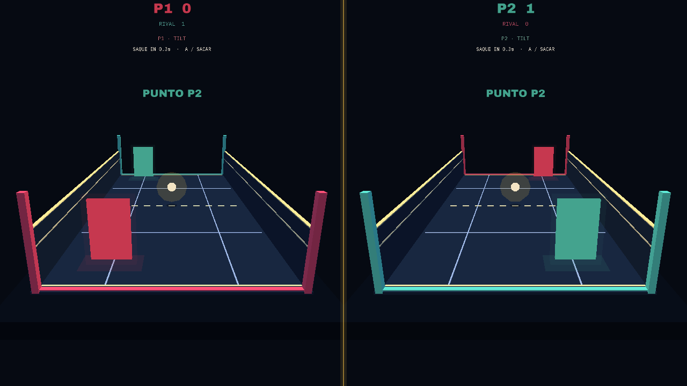

# Pong 3D

Duelo de Pong **en 3D y a pantalla dividida** para la consola Toxinator.
Cada jugador ve la cancha desde su propio lado, con el rival al fondo, y mueve
su paleta **inclinando el celular**.

[](https://github.com/skalanux/pong/actions/workflows/ci.yml)



## Controles

- **Jugador 1:** celular en el **slot 0**. Mitad izquierda de la pantalla.
- **Jugador 2:** celular en el **slot 1**. Mitad derecha de la pantalla.
- **Incliná el celular a izquierda/derecha** para mover tu paleta en tu vista.
- **×:** saca antes de que termine la cuenta y arranca una nueva partida al
  final. En teclado, **Enter** o **J**.
- **○:** reservado por la plataforma para volver.
- Gana el primero en llegar a **7**.

Antes de jugar:

1. Abrí la PWA del celular; los sensores arrancan solos (si iOS pide permiso,
   el primer toque lo concede).
2. Tocá **Calibrar** (ajustes ⋯) con el celular en la pose neutra (vertical y
   cómoda).
3. Movete a izquierda/derecha inclinando el celular.

La orientación que llega al juego es relativa a esa pose neutra. Sin celular,
el teclado/mouse funciona como P1: el mouse mueve la paleta y Enter/J saca.

## Mando y arte

El manifest declara el perfil del mando y el prop del launcher:

```toml
[controller]
layout = "motion"
skin = "toxinator"
orientation = "auto"
hint = "Incliná para mover tu paleta · × para sacar"

[controller.labels]
cross = "Sacar"
circle = "Volver"

[art]
motif = "pong"
```

El celular abre el layout de movimiento con la skin **Toxinator**, y el diorama
de Pong en el launcher usa el prop de paletas y pelota.

## Vibración y sonido

Pong usa el feedback del celular:

- **Golpe de paleta:** vibración corta + tick de audio.
- **Punto:** vibración + tono grave.
- **Victoria:** patrón de vibración más largo.

Al entrar al juego, tocá una vez el aviso **ACTIVAR SONIDO Y VIBRACIÓN**.
Ese toque desbloquea el audio y la vibración en el navegador, y prueba ambos.
Si el aviso no aparece o no hay vibración, mirá el terminal de la consola:
los mensajes `phone haptic` y `phone audio` confirman que el juego los está
mandando.

La vibración funciona en Android con **Chrome o Samsung Internet**. **Firefox
Android tiene la Vibration API deshabilitada**, así que puede decir “audio
activado” y no vibrar; en ese caso abrí el QR en Chrome. iPhone/Safari tampoco
expone vibración web. El tono usa Web Audio y necesita que el celular haya
tenido una interacción. Si no hay celular, no pasa nada. Revisá también que el
teléfono no esté en silencio o con la vibración desactivada.

## Los sensores necesitan HTTPS

El modo HTTP por defecto de Toxinator **no entrega movimiento**. Si corrés el
juego sin `--https`, la paleta no responde al inclinar y el HUD lo avisa con
`SIN SENSORES` o `TÁCTIL · --https`. En ese caso queda el touch como respaldo,
pero la gracia del juego es el tilt.

```bash
cd /home/ska/Projects/toxinator
uv run toxinator play pong --https
```

Si no querés tocar la CA del teléfono, usá el túnel HTTPS de Cloudflare:

```bash
uv run toxinator play pong --cloudflare
```

La primera vez hay que aceptar el certificado autofirmado en el celular. Con
`--cloudflare` no hay que aceptar nada: Cloudflare entrega un certificado
válido. Si usás un certificado propio:

```bash
uv run toxinator play pong --https --cert mi-cert.pem --key mi-clave.pem
```

En iPhone/iPad, el permiso de movimiento puede requerir tocar la pantalla o el
botón de calibración de la PWA después de abrir la sesión.

## Modos

- **Dos celulares:** duelo 1v1 real, una paleta por lado.
- **Un celular:** el otro lado lo juega la CPU.
- **Sin celulares o `--demo`:** modo demostración. La CPU juega ambos lados y
  la pantalla dividida sigue mostrando las dos perspectivas.

## Instalar y ejecutar

Este repo vive en el directorio de juegos externos, así que la consola lo
descubre directamente. Si lo clonás en otro lado:

```bash
cd /home/ska/Projects/toxinator
uv run toxinator install /ruta/a/pong
```

Ejecutar:

```bash
cd /home/ska/Projects/toxinator
uv run toxinator play pong --https
```

Demo sintética (P1 usa sensores simulados):

```bash
uv run toxinator play pong --demo
```

Captura headless:

```bash
uv run toxinator play pong --demo --offscreen \
  --screenshot /tmp/pong.png --screenshot-after 3 --seconds 5
```

Reiniciá el launcher si estaba abierto para que tome los cambios.

## Cómo está hecho

```text
pong/
├── src/pong/
│   ├── __init__.py       # create_game(manifest)
│   ├── manifest.toml
│   ├── rules.py          # física, puntaje, tilt y CPU sin Panda3D
│   ├── game.py           # dos cámaras, escena 3D, HUD y controles
│   └── assets/fonts/     # Archivo Black + IBM Plex Mono (OFL)
├── tests/test_rules.py
└── pyproject.toml
```

- La cancha es 3D: el jugador mira desde atrás de su paleta, el rival está al
  fondo y la pelota viene en profundidad.
- Dos `Camera` de Panda3D con dos `DisplayRegion` verticales; la cámara 3D por
  defecto se desactiva mientras dura el juego y se restaura en `stop`.
- El HUD se duplica por mitad: marcador propio, marcador del rival, estado
  (`TILT`, `TÁCTIL`, `CPU`) e instrucción.
- La lógica de juego sigue en `rules.py` y no importa Panda3D.
- El touch solo se usa si el celular no publica datos de movimiento; cuando hay
  sensores, el tilt tiene prioridad y el touch se ignora.

## Tests y calidad

```bash
cd /home/ska/Projects/toxinator-games/pong
/home/ska/Projects/toxinator/.venv/bin/pytest -q
/home/ska/Projects/toxinator/.venv/bin/ruff check src tests
/home/ska/Projects/toxinator/.venv/bin/mypy src/pong
```

## Reglas de la plataforma

- Solo se importa `toxinator.api` del runtime.
- La escena cuelga de `ctx.scene` y el HUD de `ctx.ui`.
- El input sale de `ctx.input_state`; se leen los slots 0 y 1.
- `stop()` elimina las cámaras, los `DisplayRegion`, el HUD y las fuentes.
- `requires_api = "0.1"`.
